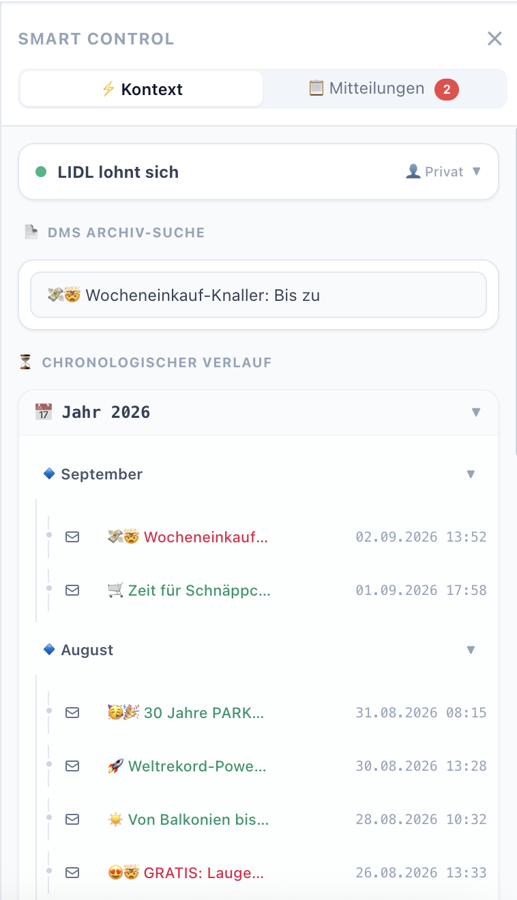
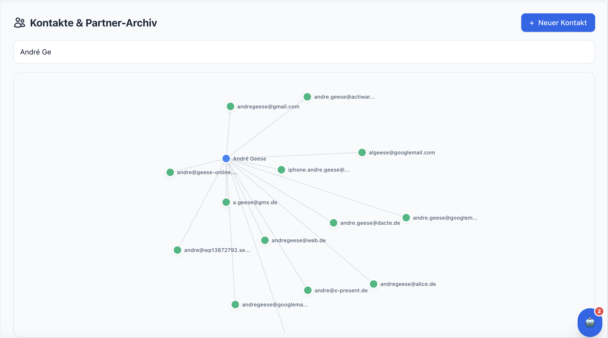
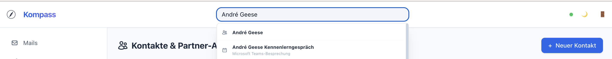

Kompass by abwurfzone
Source Available CRM System

Kompass by abwurfzone ist eine spezialisierte Digitalisierungsplattform zur effizienten Verwaltung von Korrespondenz, Kontakten und Terminen.

⚠️ Wichtige Lizenzbedingungen (BSL 1.1)
Dieses Projekt wird als "Source Available"-Software unter der Business Source License (BSL) 1.1 bereitgestellt. Wir legen den Quellcode zu Transparenzzwecken offen, damit unsere Nutzer nachvollziehen können, wie das System arbeitet.

Durch die Nutzung dieser Software akzeptieren Sie folgende Bedingungen:

Nicht-kommerzielle Nutzung: Die private und interne Nutzung ist kostenlos gestattet.

Kommerzielle Nutzung: Jegliche kommerzielle Nutzung, Modifikation, Weiterverbreitung oder das Rebranding (Weiterführung unter anderem Namen) ist ohne ausdrückliche schriftliche Genehmigung des Urhebers untersagt.

Kein "Rebranding": Es ist strikt untersagt, den Code zu verändern, um ihn als eigenes Produkt oder unter einem anderen Namen zu vertreiben.

Integrität der Lizenz: Die in den Quelldateien enthaltenen Lizenz-Header dürfen weder entfernt noch manipuliert werden.

Über dieses Projekt
Der Quellcode dient der Transparenz und der Nachvollziehbarkeit. Die Kernlogik und das Urheberrecht liegen vollumfänglich bei Kompass by abwurfzone / André Geese.

Kontakt & Genehmigungen
Für Anfragen bezüglich kommerzieller Lizenzen, Anpassungen oder Kooperationen kontaktieren Sie bitte den Urheber direkt.

Copyright (c) 2026 Kompass by abwurfzone by André Geese. All rights reserved.

# Smart-Bar: für den schnellen Überblick:


# Kontaktliste: für das Sehen der Verzweigungen


# Globale Suche


**WIR verzweigen Mails und Digitale System (hier am Beispiel von paperless-ngx) und setzen noch einen drauf in dem wir Termin und Notizen pro E-Mail-Adresse hinterlegen können.**


# 🚀 Kompass by abwurfzone

**Dein lokales Tool für E-Mails, Dokumente, Notizen und Termine – sicher gehostet bei dir.**

---

Kompass by abwurfzone ist die einfache, datenschutzkonforme Lösung für KMU und Vereine, um den Überblick über Kontakte, E-Mail-Korrespondenz und wichtige Dokumente zu behalten – ohne monatliche Abogebühren und ohne Cloud-Zwang.

## 🌟 Wozu Kompass by abwurfzone?

* **Datensouveränität:** Deine Daten bleiben bei dir auf deinem Server oder NAS. Du behältst die volle Kontrolle.
* **Alles an einem Ort:** Synchronisiere deine E-Mails mit Paperless-Dokumenten, verwalte Termine und Notizen direkt am Kontakt.
* **Schnell & Einfach:** Dank Docker in unter 5 Minuten einsatzbereit.
* **DSGVO-freundlich:** Da kein externer Dienstleister auf deine Daten zugreift, ist die Einhaltung der Datenschutzrichtlinien deutlich einfacher.

---

## ⚖️ Lizenz & Kostenmodell

### Lizenz
Dieses Projekt steht unter der **Business Source License (BSL 1.1)**. 
Das bedeutet für dich: Du darfst den Quellcode zu Transparenzzwecken frei einsehen, prüfen und für private oder interne Zwecke nutzen. Jede kommerzielle Nutzung, Modifikation, Weiterverbreitung oder das Rebranding (Weiterführung unter anderem Namen) ist ohne vorherige schriftliche Genehmigung des Urhebers jedoch untersagt. Nach Ablauf der Change Date wird diese Software automatisch in eine Open-Source-Lizenz überführt.

### Kosten
*   **Software:** Die Basis-Version ist und bleibt **kostenlos**. Es gibt keine versteckten „Paywalls“ innerhalb der Software.
*   **Dienstleistung:** Wenn du Hilfe bei der Installation, individuellen Anpassungen oder laufender Wartung benötigst, biete ich professionelle Unterstützung als Dienstleistung an.

---

## ⚡ Schnellstart (Installation in 4 Schritten)

Voraussetzungen: [Docker](https://docs.docker.com/get-docker/) und [Docker Compose](https://docs.docker.com/compose/install/) müssen installiert sein.

1. **erstelle das Dockerfile:**

```bash
# PHP 8.4 / 8.5 auf Debian Bookworm
FROM php:8.5-apache-bookworm

# 1. System-Abhängigkeiten & MySQL 9.7-Clients
RUN apt-get update && apt-get install -y \
    libzip-dev \
    zip \
    unzip \
    git \
    libc-client-dev \
    libkrb5-dev \
    default-mysql-client \
    default-libmysqlclient-dev \
    && rm -rf /var/lib/apt/lists/*

# 2. PDO und ZIP installieren
RUN docker-php-ext-install pdo pdo_mysql zip

# 3. IMAP via PECL installieren (Neu ab PHP 8.4)
RUN pecl install imap \
    && docker-php-ext-enable imap

# 4. Apache Rewrite-Modul aktivieren
RUN a2enmod rewrite

# 5. Composer installieren
COPY --from=composer:latest /usr/bin/composer /usr/bin/composer

# 6. Arbeitsverzeichnis setzen
WORKDIR /var/www/html

```


2. **Repository klonen:**
```bash

git clone https://github.com/andregeese/Kompass.git
cd /DEIN-REPO

```

3.  **Konfiguration:**
    Kopiere die Vorlage und setze deine Einstellungen:
```bash

cp .env.example .env

```

# Öffne die .env Datei und passe das DB-Passwort an
```bash

nano .env

```

4. **Compose:**
```bash

docker exec -it webserver composer dump-autoload -o --working-dir=/DEIN-REPO
```

5. **Starten:**
```bash

docker-compose up -d

```

Dein Kompass ist nun unter `http://localhost:8080` erreichbar.

---

## 🛡️ Sicherheit & Backup
Wir wissen, wie wichtig deine Daten sind. Im Ordner `/scripts` findest du ein einfaches `backup.sh` Skript, mit dem du per Knopfdruck oder Cronjob ein vollständiges Backup deines Datenbestands erstellen kannst. **Regelmäßige Backups sind der beste Schutz vor Datenverlust!**

---

## 🛠️ Support & Wartung
Du benötigst Unterstützung bei der Einrichtung oder möchtest, dass sich jemand um die Wartung und Updates kümmert?

*   **Community Support:** Nutze die [GitHub Issues](https://github.com/andregeese/Kompass/issues) für Fragen oder Fehlerberichte.
*   **Professionelle Hilfe:** Wir bieten spezielle Support-Pakete für Vereine und Unternehmen an.
    *   [Hier klicken für mehr Informationen zu unseren Wartungsverträgen]: fly@abwurfzone.de

---

## 🤝 Unterstütze das Projekt
Dieses Projekt ist Open Source. Wenn dir das Tool gefällt und du es in deinem Verein oder Unternehmen nutzt, freuen wir uns über jede Unterstützung!

*   **Sponsoring:** Werde Sponsor auf [GitHub Sponsors] und hilf uns, das Projekt aktiv weiterzuentwickeln.
*   **Feedback:** Hast du Verbesserungsvorschläge oder ein Feature, das dir fehlt? Wir freuen uns auf dein Feedback!

---
*Entwickelt mit ❤️ für Vereine und KMU.*